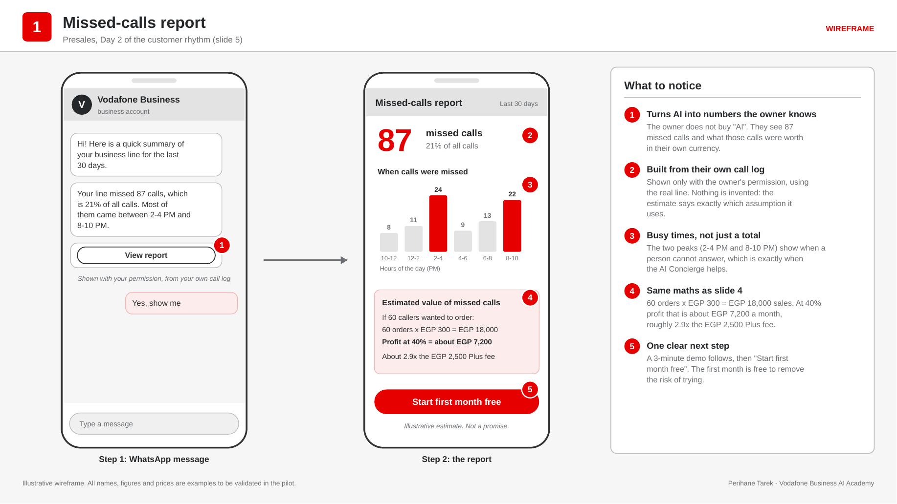
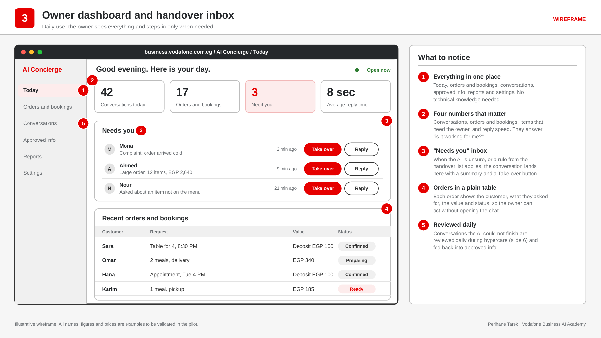
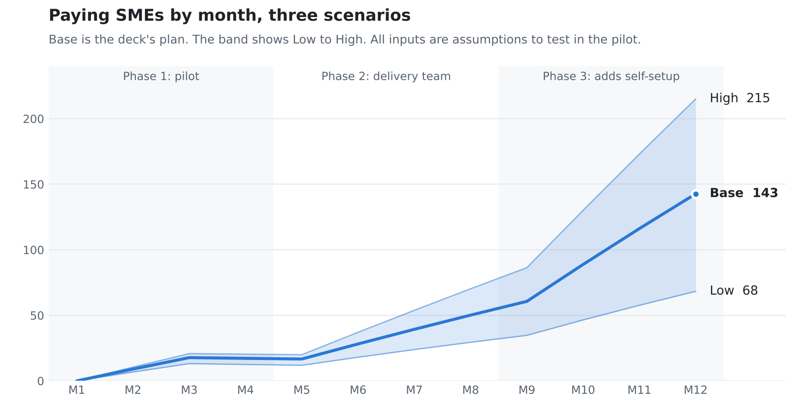

# AI Concierge for Egyptian SMEs: a 12-month business case

My business case for the **Vodafone Business AI Academy** assessment (October 2026): how Vodafone Egypt could launch an AI agent that answers the calls and WhatsApp messages small businesses miss, then grow it into an AI services hub for SMEs.

> This is my own submission, not an official Vodafone plan. Every figure is an assumption to test in a pilot unless a source is given.

📄 [The 6-slide deck (PDF)](deck/AI-Concierge-business-case-deck.pdf) · 📊 [The 12-month Excel model](model/AI-Concierge-12-month-model.xlsx) · 🖼️ [All 7 product wireframes (PDF)](wireframes/AI-Concierge-wireframes.pdf)

---

## The problem

Egyptian SMEs lose customers every time a call or WhatsApp message goes unanswered: at rush hour, after closing, or when staff are busy with the people in front of them. Those customers order through a delivery app instead (where the business pays 15-25% commission) or book with a competitor.

## The idea

An AI agent that works on the SME's own phone line and WhatsApp. It:

1. **Picks up** the calls and messages staff can't answer
2. **Answers** only from information the owner has approved
3. **Takes** orders and bookings
4. **Hands over** everything else to staff
5. Lets the **owner decide** when it answers
6. **Reports** results by WhatsApp or email, with PDF or Excel export

It's built for any phone-heavy small business. A restaurant and a clinic are used as worked examples below.

The strategy is to **not build the full hub first**. Launch one product SMEs find hard to say no to, then add services only once the previous phase has proved itself.

## Product screens

Wireframes of what the owner would actually see. All names and figures in them are examples.

**The sales hook: a missed-calls report built from the owner's own call log.** The owner isn't buying "AI", they're buying back calls they're already losing.

**Daily use: the owner dashboard and "Needs you" inbox.** The AI handles the routine conversations, and anything it can't finish lands here for staff to take over.

The other five screens:

| Screen | What it shows |
|---|---|
| [Self-setup](images/screens/2-self-setup.png) | Five template-based steps an owner can finish in under an hour, checked remotely before going live |
| [Acceptance and sign-off](images/screens/4-acceptance-and-sign-off.png) | Five acceptance tests that must all pass before the customer signs and goes live |
| [Payment link and deposit](images/screens/5-payment-link-and-deposit.png) | Phase 2: the chat sends a deposit link and the owner sees the payment arrive |
| [AI hub](images/screens/6-ai-hub.png) | Phase 3: all services on one bill, each marked active, add-on or opt-in |
| [Journey map](images/screens/7-journey-map.png) | The customer journey across presales, delivery and product, mapped to the three phases |

## Three phases, with a gate between each

| Phase | Months | What's added | Gate to move on |
|---|---|---|---|
| **1. Pilot** | 1-4 | Missed calls and WhatsApp, for 30 existing Vodafone business-line customers | At least 60% still paying after the free first month |
| **2. Delivery team** | 5-8 | 20 setups a month. Deposits and payment links, follow-up on customers who asked but didn't book, feedback and review requests | Monthly churn at most 5% |
| **3. AI hub** | 9-12 | Guided self-setup (up to 30 a month). E-receipts for the Tax Authority under Law 6 of 2025, business insights, opt-in offers to past customers | |

## Pricing and unit economics

|  | Essential | Plus |
|---|---|---|
| Price per month | EGP 1,500 | EGP 2,500 |
| Conversations included | 300 | 700 |
| Contribution per customer per month | EGP 525 | about EGP 1,190 |
| **Contribution margin** | **35%** | **about 48%** |

The first month is free. Extra conversations cost EGP 3 each, which the model leaves out of revenue to stay conservative.

Where the Essential fee goes each month: EGP 1,500 fee, minus AI usage 350, calls and WhatsApp 100, platform licence 200, support 100, onboarding 100 and sales commission 125 (one-off costs spread over 12 months), leaves **EGP 525**. That's before Vodafone's fixed costs, so it's contribution, not profit.

**Why an SME would pay:**
- *Restaurant on Plus:* 60 recovered orders × EGP 300 × 40% margin = EGP 7,200 profit a month, about 2.9× the fee. It breaks even at about 21 orders.
- *Clinic on Essential:* 5 recovered bookings at EGP 300 cover the fee.

## 12-month results

The model runs three scenarios. Low and High move conversion, churn, plan mix, setup pace and costs together.

|  | Low | Base | High |
|---|---|---|---|
| Paying SMEs at month 12 | 68 | 143 | 215 |
| Revenue in year 1 | EGP 0.58M | EGP 1.11M | EGP 1.67M |
| Revenue run-rate at month 12 | EGP 1.5M | EGP 3.3M | EGP 5.2M |
| Net contribution in year 1 | EGP -0.25M | EGP -0.11M | EGP +0.12M |
| Positive every month from | after month 12 | month 11 | month 10 |
| Payback per customer (sold by sales) | 8.1 months | 5.1 months | 3.9 months |
| Lifetime value ÷ acquisition cost | 2.5× | 6.6× | 12.8× |

<picture>
  <source media="(prefers-color-scheme: dark)" srcset="images/paying-smes-dark.png">
  
</picture>

**How to read it:**
- In Base, every customer is profitable on its own. Year 1 is slightly negative on purpose, because free months, onboarding and sales commission are paid upfront, before customers pay them back.
- In Low, each customer still has a positive margin, but lifetime value falls to 2.5× acquisition cost, under the usual 3× rule of thumb. That's what the phase gates are for: they stop the rollout before a weak result gets scaled.
- Growth is capped by delivery capacity, not by market size. That's why the curve gets much steeper once self-setup starts in Phase 3.

## How the model works

Open [`model/AI-Concierge-12-month-model.xlsx`](model/AI-Concierge-12-month-model.xlsx) and pick Low, Base or High in the yellow cell on the **Summary** sheet. Every blue cell on **Inputs** is an assumption you can change.

| Sheet | What it does |
|---|---|
| Summary | Scenario switch, key results, talking points |
| Inputs | Every assumption in Low, Base and High columns, with a note or source for each |
| Monthly | Setups, paying customers, revenue, running costs and growth costs month by month |
| Unit economics | Per-customer margin, a usage sensitivity table, payback and lifetime value |
| Pipeline | How many SMEs sales must contact (about 100 contacted → 40 missed-calls reports → 20 sign-ups → 12 paying) |
| SME value | The restaurant and clinic examples, editable to test any business |

**Logic:** a setup in month *t* starts its free month and becomes a paying customer in month *t+1* at the conversion rate. Paying customers then churn at a fixed monthly rate.

**Left out on purpose:** revenue from extra conversations, bundle uplift on phone and mobile lines, the Phase 2-3 hub services, and Vodafone's fixed costs (staff, marketing, building the Arabic language layer).

## Sources

- Vodafone 010Hotline business line prices: Vodafone Business Digital Store (EGP 600 and 750 a month, excluding VAT)
- AI Concierge: Google Cloud press release, 22 April 2026
- Delivery-app commission of 15-25%: industry estimate
- E-receipt requirement for small businesses: Egypt's Law No. 6 of 2025 (simplified tax regime)

All other figures are my assumptions.
